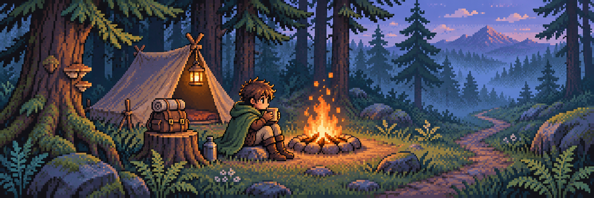

  

<h1 align="center">OLBIz · Campfire Checkpoint</h1>

  Learning to code and exploring neural networks. 
  Учусь программировать и разбираюсь в нейросетях.

## 01 · Quest log / Журнал проектов

**[Campfire Checkpoint](https://github.com/OLBIz/OLBIz)**\
A bilingual GitHub profile with a pixel art scene inspired by classic RPGs.\
Двуязычный GitHub-профиль с пиксельной сценой в духе классических RPG.

[Browse repositories ↗ / Все репозитории](https://github.com/OLBIz?tab=repositories)

## 02 · Inventory / Стек

Tools I’ve worked with / Инструменты, с которыми я пробовал работать:

- **AI & data / ИИ и данные:** `Python` · `PyTorch` · `TensorFlow` · `scikit-learn` · `NumPy` · `pandas` · `Jupyter`
- **Web / Веб:** `JavaScript` · `HTML` · `CSS`
- **Dev tools / Среда:** `Git` · `GitHub` · `VS Code` · `Linux`

---

✦ Save point reached · Точка сохранения ✦

