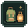
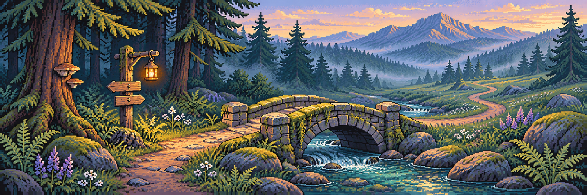

  

<h1 align="center">OLBIz · Campfire Checkpoint</h1>

  <strong>Learning to code and exploring neural networks.</strong> 
  Учусь программировать и разбираюсь в нейросетях.

  <a href="#-about--обо-мне">About / Обо мне</a> ·
  <a href="#-inventory--стек">Stack / Стек</a> ·
  <a href="#-quest-log--проекты">Projects / Проекты</a>

## 🧭 About / Обо мне

<table>
  <tr>
    <td>
      I’m building my programming skills with small experiments. I’m especially interested in how neural networks learn and how to try out ideas in Jupyter notebooks.
        
      Учусь программировать на небольших экспериментах. Больше всего мне интересно, как учатся нейросети и как проверять идеи в Jupyter.
    </td>
    <td align="center" width="132">
      
    </td>
  </tr>
</table>

## 📊 GitHub activity / Активность

<table>
  <tr>
    <td width="50%" align="center">
      <strong>Profile / Профиль</strong>  
       
      
    </td>
    <td width="50%" align="center">
      <strong>Contribution calendar</strong> 
      Календарь вкладов  
      <a href="https://github.com/OLBIz#js-contribution-activity-description">View calendar ↗ / Открыть</a>
    </td>
  </tr>
</table>

## 🎒 Inventory / Стек

  

- **AI & data / ИИ и данные:** `Python` · `PyTorch` · `TensorFlow` · `scikit-learn` · `NumPy` · `pandas` · `Jupyter`
- **Web / Веб:** `JavaScript` · `HTML` · `CSS`
- **Tools / Инструменты:** `Git` · `GitHub` · `VS Code` · `Linux`

## 📖 Quest log / Проекты

<table>
  <tr>
    <td>
      01 · FEATURED PROJECT / ПРОЕКТ  
      <strong><a href="https://github.com/OLBIz/OLBIz">Campfire Checkpoint ↗</a></strong> 
      A bilingual GitHub profile with two pixel art scenes from the same RPG world. 
      Двуязычный GitHub-профиль с двумя пиксельными сценами из одного RPG-мира.  
      <code>Markdown</code> · <code>Pixel art</code>
    </td>
  </tr>
</table>

  <a href="https://github.com/OLBIz?tab=repositories">Browse repositories ↗ / Все репозитории</a>

---

  
  ✦ The trail continues · Путь продолжается ✦

